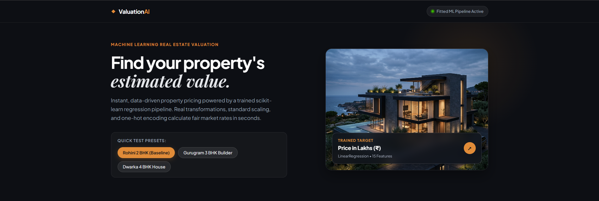
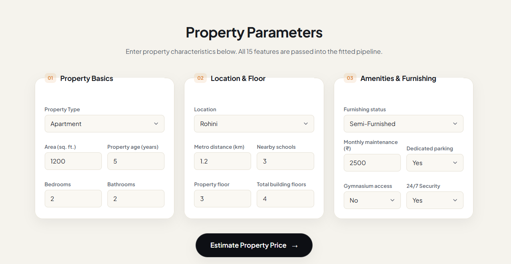
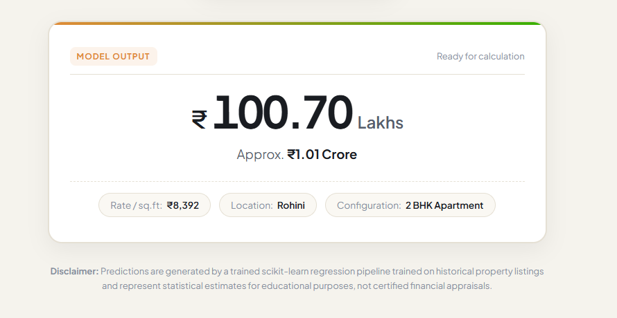

# ValuationAI — Property Price Prediction

A machine-learning-powered real estate valuation web app that estimates residential property prices from property characteristics and location-related features. The project brings together a complete regression workflow—from data cleaning and exploratory data analysis to preprocessing, model inference, and a Flask web interface.

> **Note:** Predictions are statistical estimates based on the training data, for educational and demonstration purposes. They are not certified property valuations or financial advice.

## Preview

### Landing page



The landing page introduces the app and includes quick-test presets to try example property configurations.

### Property inputs



The form groups the inputs into Property Basics, Location & Floor, and Amenities & Furnishing.

### Prediction result



The results panel displays an estimated price in lakhs, an approximate crore equivalent, and contextual details such as estimated rate per square foot, location, and configuration.

## Features

- **End-to-end regression workflow:** data cleaning, EDA, feature engineering, preprocessing, training, and inference.
- **Saved scikit-learn pipeline:** preprocessing and prediction are packaged together for consistent inference on new inputs.
- **Interactive web interface:** enter property characteristics and request an estimated price.
- **Quick-test presets:** populate the form with sample property configurations.
- **Categorical and numerical inputs:** supports property, location, furnishing, amenities, size, age, floor, and nearby-infrastructure features.
- **Prediction context:** presents the estimate alongside helpful property details.
- **Educational disclaimer:** clarifies that predictions are estimates, not professional appraisals.

## Tech stack

- **Language:** Python
- **Machine learning:** scikit-learn
- **Data work:** pandas, NumPy, Jupyter Notebook
- **Web backend:** Flask
- **Frontend:** HTML, CSS, JavaScript
- **Model persistence:** joblib

## Project structure

```text
Property_Price_Prediction/
├── data/
│   ├── cleaned_property_price.csv
│   └── property_price_regression_practice.csv
├── models/
│   └── property_price_pipeline.joblib
├── notebooks/
│   ├── 01_data_cleaning.ipynb
│   ├── 02_eda.ipynb
│   ├── 03_feature_engineering.ipynb
│   ├── 04_model_experimentation.ipynb
│   └── 05_model_inference.ipynb
├── notes/
│   ├── 01_data_cleaning.txt
│   ├── 02_eda.txt
│   └── 03_feature_engineering.txt
├── web_app/
│   ├── app.py
│   ├── static/
│   │   ├── hero_property.jpg
│   │   ├── script.js
│   │   └── style.css
│   └── templates/
│       └── index.html
├── docs/
│   └── screenshots/
│       ├── hero.png
│       ├── property-parameters.png
│       └── prediction-result.png
├── requirements.txt
└── README.md
```

## Run locally

### 1. Clone the repository

```bash
git clone https://github.com/Riya-J05/property-price-detection.git
cd property-price-detection
```

### 2. Create and activate a virtual environment

**Windows PowerShell**

```powershell
py -m venv .venv
.\.venv\Scripts\Activate.ps1
```

**macOS / Linux**

```bash
python3 -m venv .venv
source .venv/bin/activate
```

### 3. Install dependencies

```bash
python -m pip install --upgrade pip
pip install -r requirements.txt
```

### 4. Start the Flask app

From the repository root, run:

```bash
python web_app/app.py
```

Open the local URL printed in the terminal (commonly `http://127.0.0.1:5000`). If the app reports a missing model or file path, check that the paths in `web_app/app.py` are resolved relative to the project root and that `models/property_price_pipeline.joblib` exists.

## Model workflow

1. **Data cleaning** — inspect and prepare the property dataset.
2. **Exploratory data analysis** — study feature distributions and relationships.
3. **Feature engineering** — select and prepare numerical and categorical features.
4. **Preprocessing pipeline** — apply suitable transformations to numerical features and encode categorical features.
5. **Model experimentation** — train and evaluate regression models using a train/test split.
6. **Model persistence** — save the fitted preprocessing-and-model pipeline with joblib.
7. **Inference** — pass new property inputs through the saved pipeline to generate an estimate.
8. **Web integration** — collect user inputs through the Flask interface and display the prediction.

The interface identifies the trained target as **Price in Lakhs (₹)** and shows a Linear Regression model with 15 features. The displayed sample result in the screenshot is an example UI output, not a claim about the model's general accuracy.

## Example input features

The interface collects property characteristics such as:

- Property type and location
- Area in square feet
- Property age
- Bedrooms and bathrooms
- Distance to metro and nearby schools
- Property floor and total building floors
- Furnishing status
- Monthly maintenance
- Parking, gym access, and security

## Future improvements

- Add model evaluation results such as MAE, RMSE, and R² with the evaluation split clearly documented.
- Compare Linear Regression with additional regression algorithms.
- Add input validation and clearer error messages.
- Deploy the Flask app so others can try it online.
- Add automated tests for preprocessing and prediction.

## Limitations

- The model's estimates depend on the coverage, quality, and representativeness of the training data.
- Market prices change over time and vary with property-specific factors that may not be represented in the dataset.
- The app is a learning project and should not be used as a substitute for a professional property valuation.

## Author

**Riya Johari**

GitHub: [@Riya-J05](https://github.com/Riya-J05)

---

Built as a hands-on project to practice regression, scikit-learn pipelines, model persistence, and integrating machine learning with a Flask web application.
